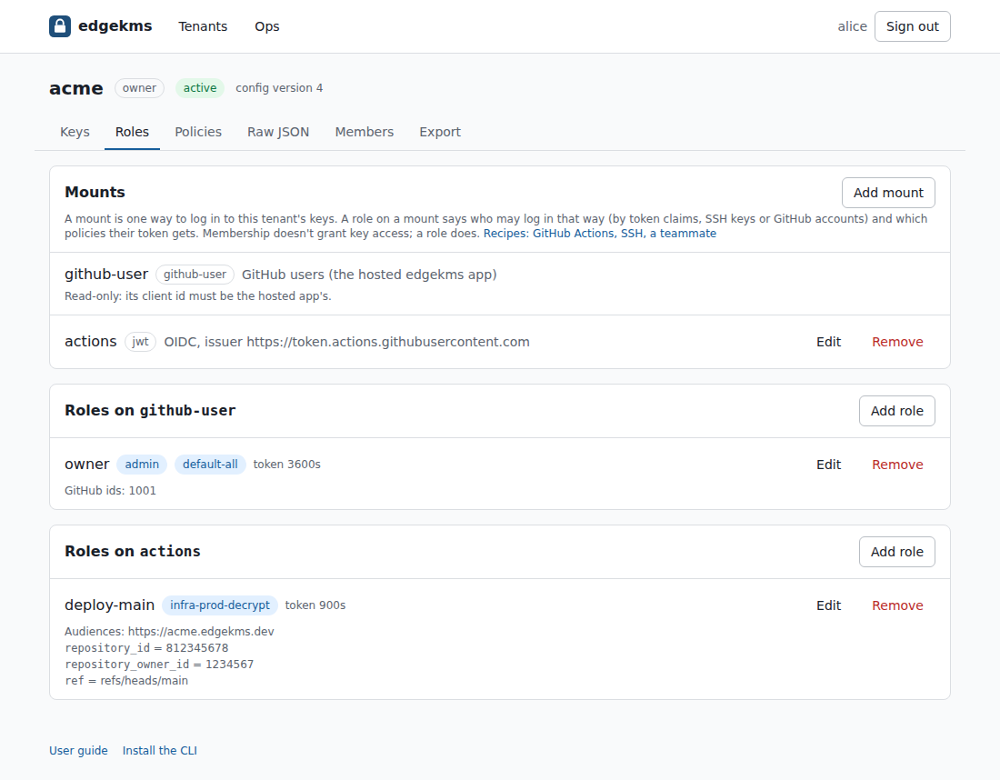

# edgekms

A key management service on Cloudflare Workers. It is API compatible with Vault's Transit
secrets engine, so Pulumi's `hashivault://` secrets provider, OpenBao's `transit` auto-unseal,
SOPS and other Vault clients use it unchanged. Callers log in with an OIDC token (GitHub Actions,
Cloudflare Access, Kubernetes service accounts) and get a short-lived token scoped by policy to
the keys they may use. No long-lived secret sits in any CI system.

Status: running as a hosted service at [edgekms.dev](https://edgekms.dev) (signups by invite),
and self-hostable from the examples in [deploy/](deploy/). The CLI is released from this repo.

[How it works](docs/how-it-works.md) is the overview; the [API](docs/api.md) and the
[security model](docs/security-model.md) are the reference, and [docs/design.md](docs/design.md)
keeps the reasoning behind them.

## Hosted or self-hosted

The same Worker runs both ways.

- **Hosted, at `edgekms.dev`.** Log in with your GitHub account and you get a tenant,
  `https://<you>.edgekms.dev`, with its own root key, keys, roles and policies. You manage it from
  the CLI or the [web console](#web-console); there's nothing to deploy, and you can export the
  root key and leave at any time.

  ```sh
  export EDGEKMS_CONTROL_TOKEN="$(edgekms account login)"
  export VAULT_ADDR=https://<you>.edgekms.dev
  export VAULT_TOKEN="$(edgekms login github --addr "$VAULT_ADDR" --role owner \
    --client-id "$(curl -fsS https://api.edgekms.dev/v1/info | jq -r .github_client_id)")"
  ```

  The walkthrough, from first login to invitations and export, is
  [docs/hosted-quickstart.md](docs/hosted-quickstart.md).

- **Self-hosted.** Deploy the Worker into your own Cloudflare account with your own root key and a
  `config.json`: copy [deploy/example/](deploy/example/README.md), fill in your account, domain
  and keys, and deploy. Your Cloudflare account then holds the root key, and a config change is a
  commit and a deploy. To run your own multi-tenant service, with GitHub sign-in, the control
  plane and the web console, start from [deploy/example-hosted/](deploy/example-hosted/README.md)
  instead.

A Worker is hosted when its `HOSTED_APEX` var is set and single-tenant otherwise; the
[design](docs/design.md#hosted-tier) has the details.

## Install the CLI

Release binaries for Linux (x86_64, aarch64) and macOS (Apple silicon) are on the
[releases page](https://github.com/lokkju/edgekms/releases), each with a `THIRD-PARTY-NOTICES`
file. With mise: `mise use -g github:lokkju/edgekms`.

## Web console

Hosted tenants also have a web console at [app.edgekms.dev](https://app.edgekms.dev). Sign in with
GitHub to see your tenants and invites, create a tenant, edit its keys, roles and policies, invite
people to manage it, and export its root key. It's a client of the same control API as the CLI,
under the same rules.



The [console guide](docs/console.md) covers each screen, with recipes for GitHub Actions, SSH keys
and a teammate's GitHub account, and the CLI command behind each action.

## Contributing and security

Issues are welcome; see [CONTRIBUTING.md](CONTRIBUTING.md) before a pull request. Report
vulnerabilities privately as [SECURITY.md](SECURITY.md) describes.

## License

[PolyForm Shield 1.0.0](LICENSE). Copyright Loki Coyote.

Vault is a trademark of HashiCorp. edgekms is not affiliated with HashiCorp or Cloudflare.
