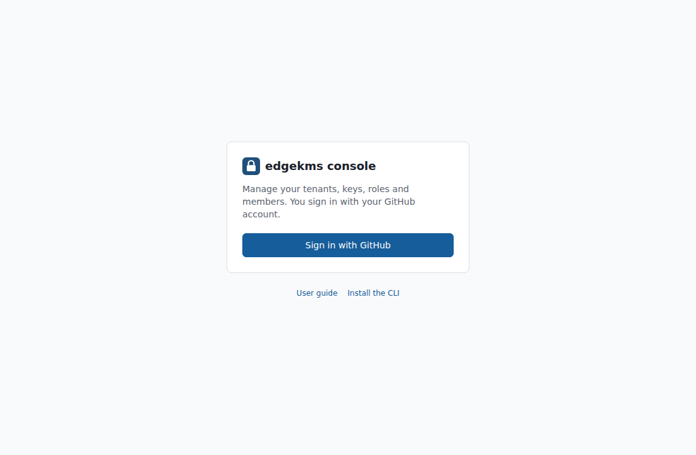
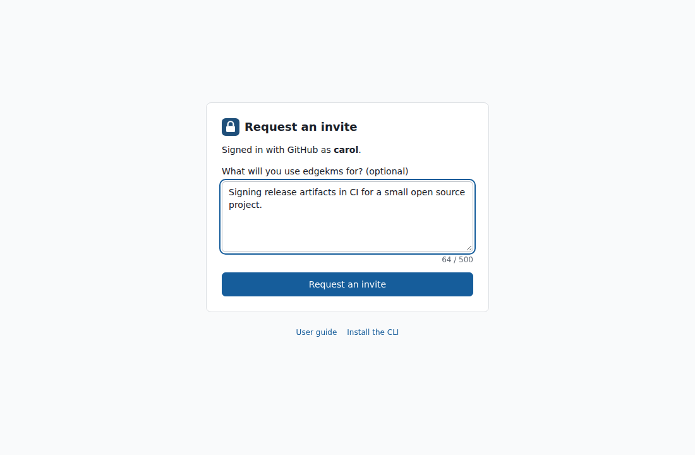
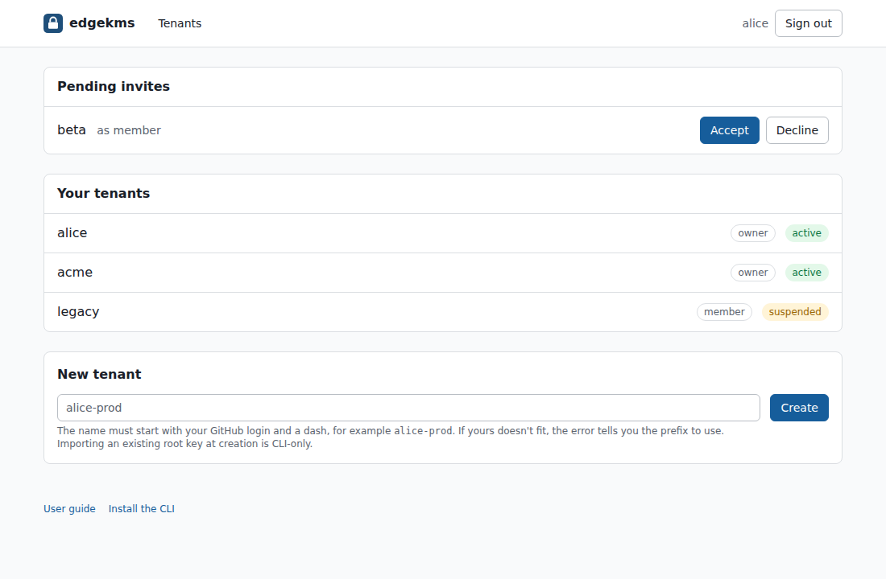
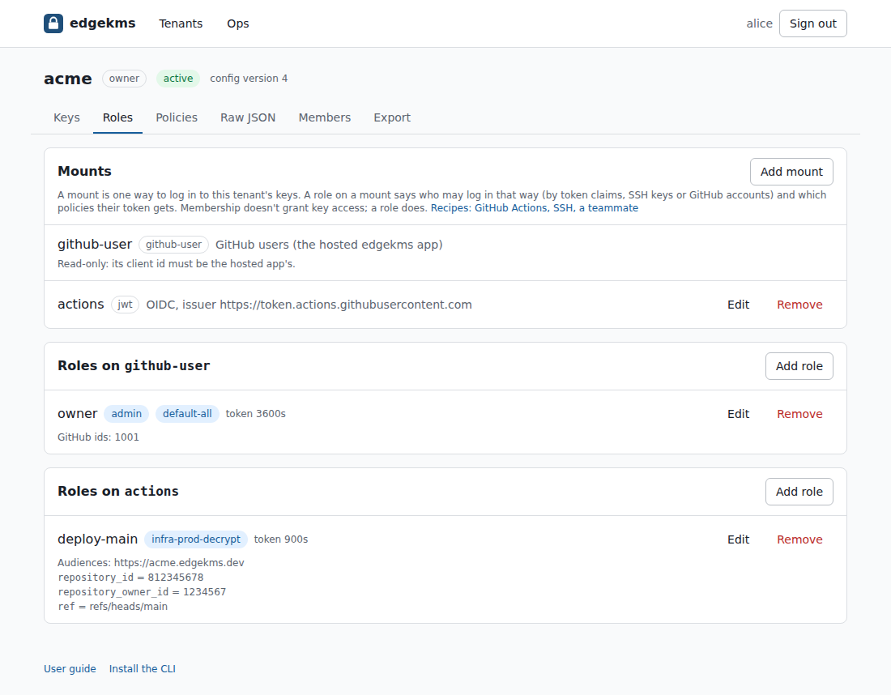
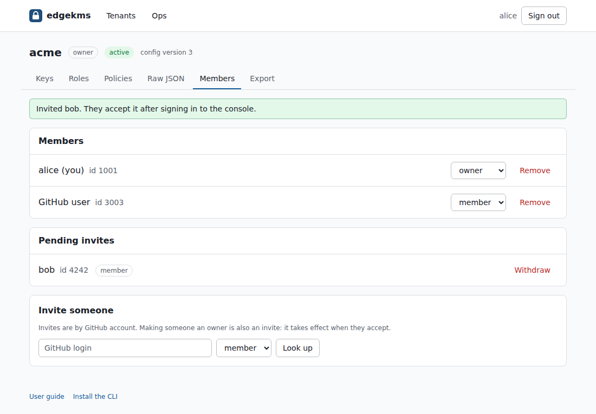
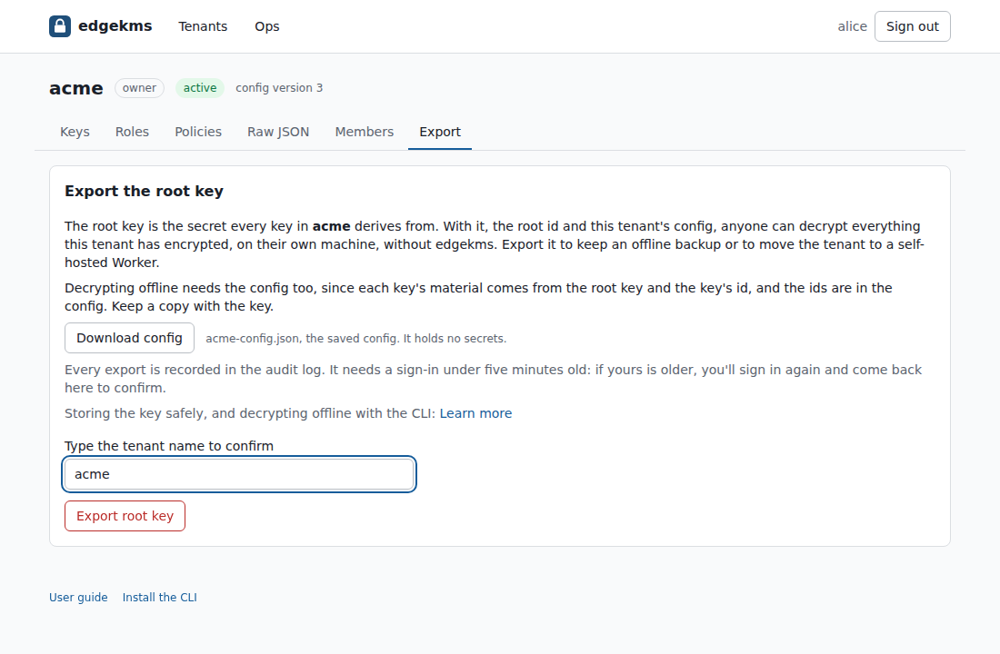
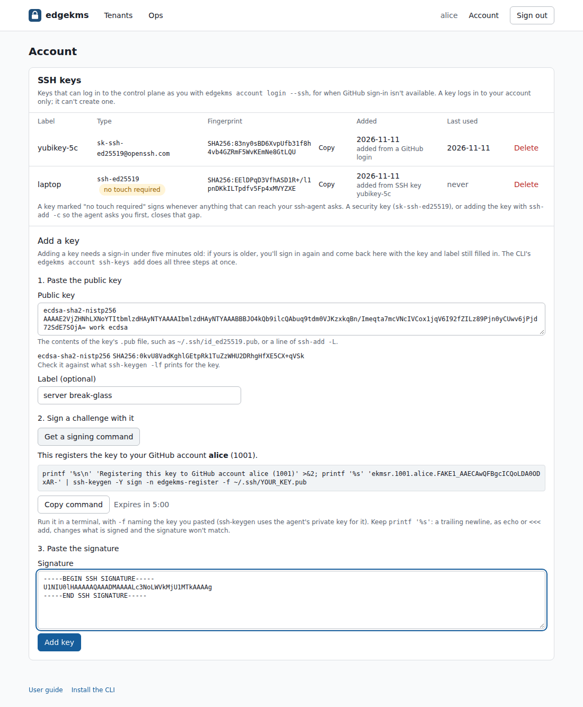
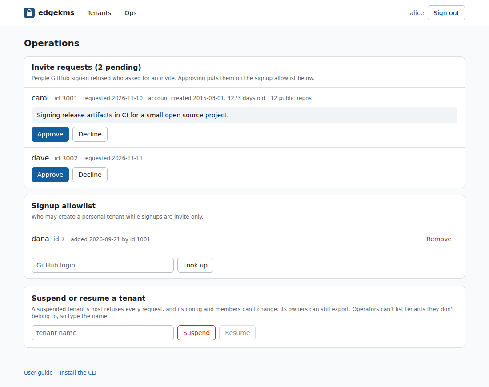

# The web console

The web console at [app.edgekms.dev](https://app.edgekms.dev) manages your hosted edgekms tenants
from a browser: their keys, roles and policies, who else can manage them, and exporting the root
key, plus the [SSH keys](#account) that can log the CLI in to your account. It's a client of the same control API the `edgekms` CLI uses, so it can't do anything the
CLI can't, and every rule below (who may sign in, how tenants are named, what a config may
contain) is the server's, enforced the same way for both. The [last section](#console-and-cli)
maps each console action to its CLI command.

The console manages tenants. Your programs never talk to it: they use the tenant itself,
`https://<tenant>.edgekms.dev`, as a Vault Transit server, as the
[hosted quickstart](hosted-quickstart.md#3-use-your-tenant-with-a-vault-client) describes.

## Signing in



Open [app.edgekms.dev](https://app.edgekms.dev) and click **Sign in with GitHub**. The first time,
GitHub asks you to authorize the edgekms app; it asks for no permissions beyond who you are.
GitHub then sends you back to the console, signed in.

edgekms.dev is invite-only for now. You can sign in if any of these is true:

- an operator has put your GitHub account on the signup allowlist;
- you already belong to a tenant (as an owner, or as a member of an active tenant);
- you have a pending invite to an active tenant;
- you're one of the service's operators.

Your first sign-in as an allowlisted user creates your [personal tenant](#tenants). Signing in on
an invite alone gets you into the console to accept it, but no tenant of your own. If none of
these is true, the console takes you to [Requesting an invite](#requesting-an-invite) instead.

If the sign-in doesn't work, the sign-in page says why:

| Code in the address | What the page says | What to do |
|---|---|---|
| `signup_closed` | edgekms isn't taking new signups right now. If someone invited you to a tenant, sign in again after they send the invite. | Signups are closed, so there's no invite request to file either. Ask an owner to invite you to their tenant. |
| `github_denied` | GitHub didn't authorize the sign-in. | Sign in again and approve the app when GitHub asks. |
| `state` | That sign-in didn't complete, or it was already used. | Sign in again. A sign-in that takes over ten minutes ends this way. |
| `rate_limited` | Too many sign-in attempts from your network. | Wait a few minutes. |
| `login_failed` | Sign-in failed on our side. | Try again in a moment. |

A session lasts 30 minutes from sign-in, however busy you are. When it runs out, your next click
sends you through GitHub again and back to the page you were on. The round trip reloads the page,
so save config edits before the 30 minutes are up; unsaved edits don't survive it. Twenty-five
minutes after you sign in, a banner at the top says "Your session ends in 5 minutes; save your
changes." The console only knows when you signed in on the page load that sign-in returned to, so
after you reload the page yourself there's no banner; sign out and in again to restart the clock.

**Sign out**, top right, ends every edgekms control session you hold, the CLI's included: it's the
same as `edgekms account logout`, so an `EDGEKMS_CONTROL_TOKEN` in a terminal stops working too.
It doesn't touch the tenant tokens your programs use (`VAULT_TOKEN`).

## Requesting an invite



When GitHub sign-in works but edgekms doesn't admit your account yet, the console sends you to
[app.edgekms.dev/request-invite](https://app.edgekms.dev/request-invite), signed in as your GitHub
account for this one purpose. Say in a sentence what you'll use edgekms for (optional, at most 500
characters, plain text) and click **Request an invite**. The page shows the date you asked, and an
operator reviews the request.

edgekms doesn't email you, and holds no address to email. Sign in again later: once an operator
approves you, signing in creates your personal tenant and takes you straight to it, and until then
the page shows your request's date and status. A request that wasn't approved says so, and you
can't file another one unless an operator deletes it.

You have 15 minutes from the sign-in to send the request. If they run out while you're typing,
the page says so; copy your note, then sign in again, since the round trip through GitHub reloads
the page. Each GitHub account files one request. If the queue is full, or the service has stopped
taking requests, the page says to try again later.

Opened directly, the page offers **Sign in with GitHub**. If you already have access, that signs
you in as usual and takes you to your tenants.

`edgekms account request-invite` does the same from a terminal, without a browser: it runs GitHub's
device flow, then shows your request's status or files a new one (`--note "..."`, or it asks).

## Tenants



The **Tenants** page lists every tenant you belong to, with your role in it (`owner` or `member`)
and its status. Invites waiting for you sit above it, under **Pending invites**, with **Accept**
and **Decline** buttons.

Your personal tenant is the one your first sign-in created. It's named after your GitHub login in
lowercase, or the login and four random hex digits (`alice-3f9a`) when that name is taken or not
allowed. It starts with the default config:

- one key, `default`;
- the `github-user` mount, for logging in with a GitHub account;
- an `owner` role that lets your GitHub account log in to the tenant with the policies `admin` and
  `default-all`;
- the `admin` policy (mint and revoke tokens) and `default-all` (every capability on `default`).

To create another tenant, type a name under **New tenant** and click **Create**. A new tenant gets
a fresh root key and the same default config. The name:

- must start with your GitHub login and a hyphen: if you sign in as `Alice`, `alice-prod` and
  `alice-ci` work and `prod` doesn't. The login is folded first: lowercased, with anything outside
  `a-z` and `0-9` turned into a hyphen. If yours doesn't fit, the error names the prefix to use
  (`tenant name must start with alice-`);
- is 3 to 32 characters of lowercase letters, digits and single hyphens, with no hyphen at either
  end, and can't start with `edgekms`.

You can create up to five tenants, your personal tenant included. Creating one needs a place on
the allowlist or a tenant you've already created; belonging to someone else's tenant isn't
enough (the error is `signups are closed`). Creating a tenant from an existing root key is
CLI-only (`edgekms tenant create --import-root-id`).

Open a tenant to see its tabs. The header shows your role, the status, and the config version,
which goes up by one with every save.

A tenant is **active** or **suspended**. Only an operator suspends a tenant. While it's suspended,
its host (`https://<tenant>.edgekms.dev`) refuses every request, its config and members can't
change, and nobody can accept an invite to it. Its owners can still [export](#export) the root
key, so suspension never locks you out of your own keys.

Owners change everything. Members can read the config and see the members, and nothing more: the
config tabs say "Only owners can change the config. You can read it.", and the Export tab isn't
there.

## Editing a config

The **Keys**, **Roles**, **Policies** and **Raw JSON** tabs are four views of one config, the same
JSON a self-hosted edgekms reads. Your changes collect in the browser until you click **Save** in
the bar at the bottom; **Discard** throws them away. Switching tabs keeps them.

On save, the server checks the whole config and refuses it with the first problem it finds,
naming the path (for example `invalid config: roles.ops: an SSH role needs ssh_keys`). The message
shows at the top of the page and your edits stay put. A saved config reaches every edge location
within about 30 seconds.

Each save names the version it replaces. If someone else saved in the meantime, from the console
or the CLI, the console says "This config changed elsewhere.", loads the newer version, and shows
yours below it. Re-enter your change on the newer version, or click **Load my version into the
editor** and save to overwrite theirs on purpose.

The hosted service adds a few rules to the config: leave `root_id` alone, leave out
`public_origins`, keep the `github-user` mount's `client_id` as it is, and point no `jwks_url` at
`edgekms.dev`. A config holds at most 64 keys, 32 mounts, 128 roles and 128 policies.

## Keys

**Add key** takes a name (1 to 128 of `A-Z`, `a-z`, `0-9`, `_` and `-`) and gives the key a random
id. Save, then grant it in a policy before anything can use it.

The table's columns:

- **Id** is where the key's material comes from: each key is derived from the tenant's root key
  and its id, and nothing else is stored. The name is only a label. Two keys with different ids
  are different keys, even under the same name.
- **Latest version** is the version `encrypt` uses. Raising it rotates the key: new ciphertext
  uses the new version, and old ciphertext still decrypts.
- **Min decryption version** is the oldest version `decrypt` accepts. Raising it retires older
  versions; `rewrap` moves old ciphertext to the latest version first.

Each row has **Rotate**, which raises the latest version by one. Once a key has more than one
version, **Raise minimum** opens a form for a new minimum decryption version, from one above the
current minimum up to the latest version. It warns that ciphertext under any older version stops
decrypting, and asks again before it changes the config. Rewrap old ciphertext first. Both
changes, like every other, take effect when you click **Save**.

The forms never remove a key. Removing one leaves everything encrypted under it undecryptable
until someone adds it back with the same id, and a click is too easy a way to do that.

Use the **Raw JSON** tab for what the forms don't do:

- lowering a key's minimum decryption version, which makes its older versions decrypt again;
- removing a key (remove it from every policy too, or the save is refused);
- renaming a key while keeping its id, and so its material;
- pasting in a config from elsewhere, such as a self-hosted instance's.

The Raw JSON editor flags JSON that doesn't parse and won't save it.

## Mounts and roles

A mount is one way to log in to the tenant; a role on a mount says who may log in that way and
which policies their token gets. The **Roles** tab lists the mounts first, then each mount's roles.



**Add mount** offers three types:

- **SSH keys**: callers sign a challenge with an SSH key that a role lists.
- **GitHub Actions (OIDC)**: GitHub's OIDC issuer and its key set, filled in for you.
- **Other OIDC**: any other OIDC issuer, with its signing keys from a JWKS URL or pasted inline
  (Google, Cloudflare Access, a Kubernetes cluster).

The `github-user` mount, which a new tenant starts with, is read-only here: its client id must be
the hosted app's. A mount can't be removed while a role uses it.

Every role has a **Role name**, a **Token lifetime (seconds)** from 60 to 34,560,000 (400 days),
at least one policy under **Policies**, and **Not before (Unix seconds)**, which you can leave at
0. A token issued before **Not before** is refused, so raising it to now cuts off every token
already issued for the role. The rest of the form depends on the mount type, as the recipes below
show. Removing a role that holds an admin policy asks first, since it may be the only way anyone
can mint tokens.

### GitHub Actions for a repository or branch

This lets the workflows on `main` in one repository decrypt with a key `infra-prod`, and nothing
else. The tenant in the examples is `acme`.

1. On **Keys**, add `infra-prod`.
2. On **Policies**, add a policy `infra-prod-decrypt` and tick **decrypt** on the `infra-prod` row.
3. On **Roles**, click **Add mount**, name it `actions`, leave the type at **GitHub Actions
   (OIDC)**, and click **Add mount**.
4. Under **Roles on actions**, click **Add role**. Name it `deploy-main`, set the token lifetime
   to `900`, and tick `infra-prod-decrypt`.
5. **Bound audiences** already holds `https://acme.edgekms.dev`, your tenant's URL. The workflow
   asks GitHub for a token with this audience, so a GitHub token minted for some other service
   isn't accepted here.
6. Under **GitHub repository**, enter `acme/app` as the repository and `main` as the branch, and
   click **Look up repository**. The console asks GitHub for the repository's numeric id and its
   owner's, and shows them: "Found acme/app: repository id 812345678, owner acme id 1234567."
   Click **Bind acme/app**. That fills in three bound claims:
   - `repository_id`, exact, the repository's numeric id;
   - `repository_owner_id`, exact, the owner's numeric id;
   - `ref`, exact, `refs/heads/main`.
7. Click **Add role**, then **Save**.

The preset binds the numeric ids, not `repository` and `repository_owner`: a deleted repository's
or organization's name can be registered again by someone else, and a role bound to the name would
trust them. You can still type `repository` or `repository_owner` under **Bound claims** by hand;
the form marks each one "can be renamed; prefer ids". The lookup sees public repositories only.
For a private one, add the claims by hand, with the ids from
`gh api repos/acme/app --jq '{id, owner_id: .owner.id}'`. Every bound claim must match, and the
token's `aud` must be one of the bound audiences. GitHub's claims are documented in
[About security hardening with OpenID Connect](https://docs.github.com/en/actions/security-for-github-actions/security-hardening-your-deployments/about-security-hardening-with-openid-connect).

The saved config then has, besides what was there:

```json
{
  "keys": {
    "infra-prod": { "id": "k_3f9a1c7e5b2d4086", "latest_version": 1, "min_decryption_version": 1 }
  },
  "mounts": {
    "actions": {
      "type": "jwt",
      "issuer": "https://token.actions.githubusercontent.com",
      "jwks_url": "https://token.actions.githubusercontent.com/.well-known/jwks"
    }
  },
  "roles": {
    "deploy-main": {
      "mount": "actions",
      "bound_audiences": ["https://acme.edgekms.dev"],
      "bound_claims": {
        "repository_id": "812345678",
        "repository_owner_id": "1234567",
        "ref": "refs/heads/main"
      },
      "policies": ["infra-prod-decrypt"],
      "token_ttl_secs": 900
    }
  },
  "policies": {
    "infra-prod-decrypt": { "keys": { "infra-prod": ["decrypt"] } }
  }
}
```

For more than one branch, enter a branch with a `*` in the preset (`release/*`), or set **Match**
to **glob** for `ref`. In a glob only `*` is special, and
it matches any run of characters, slashes included: `refs/heads/release/*` admits every release
branch, and `refs/tags/v*` every tag starting with `v`. A glob without a `*` is refused. To admit
every branch and tag of the repository, leave `ref` out:

```json
{
  "roles": {
    "release-branches": {
      "mount": "actions",
      "bound_audiences": ["https://acme.edgekms.dev"],
      "bound_claims": {
        "repository_id": "812345678",
        "repository_owner_id": "1234567",
        "ref": { "glob": "refs/heads/release/*" }
      },
      "policies": ["default-all"],
      "token_ttl_secs": 900
    }
  }
}
```

GitHub's `environment` claim works the same way, for a role only a deployment environment's jobs
can use; the preset's **Environment** field adds it.

In the workflow, give the job `id-token: write`, then swap GitHub's token for an edgekms token at
the mount's login path, `/v1/auth/actions/login`:

```yaml
permissions:
  id-token: write
  contents: read

steps:
  - name: Log in to edgekms
    run: |
      jwt=$(curl -fsS -H @<(printf 'Authorization: Bearer %s\n' "$ACTIONS_ID_TOKEN_REQUEST_TOKEN") \
        "$ACTIONS_ID_TOKEN_REQUEST_URL&audience=https://acme.edgekms.dev" | jq -r .value)
      token=$(jq -n --arg jwt "$jwt" '{role: "deploy-main", jwt: $jwt}' |
        curl -fsS -X POST -H 'Content-Type: application/json' -d @- \
          https://acme.edgekms.dev/v1/auth/actions/login | jq -r .auth.client_token)
      echo "::add-mask::$token"
      echo "VAULT_ADDR=https://acme.edgekms.dev" >> "$GITHUB_ENV"
      echo "VAULT_TOKEN=$token" >> "$GITHUB_ENV"
```

`hashicorp/vault-action` does the same with `method: jwt`, `path: actions`, `role: deploy-main`
and `jwtGithubAudience: https://acme.edgekms.dev`.

### An SSH key

This lets you log in from a laptop with an SSH key, including one held in ssh-agent or a FIDO
security key.

1. On **Roles**, click **Add mount**, name it `laptops`, choose **SSH keys**, and click **Add
   mount**.
2. Under **Roles on laptops**, click **Add role**, name it `ops`, and tick the policies it should
   have.
3. Paste your public key (the contents of `~/.ssh/id_ed25519.pub`) under **SSH public keys, one
   per line**. Keys of type `ssh-ed25519`, `sk-ssh-ed25519@openssh.com` and `ecdsa-sha2-nistp256`
   work; RSA keys don't. Add one line per key that may use the role.
4. Click **Add role**, then **Save**.

```json
{
  "mounts": {
    "laptops": { "type": "ssh" }
  },
  "roles": {
    "ops": {
      "mount": "laptops",
      "ssh_keys": [
        "ssh-ed25519 AAAAC3NzaC1lZDI1NTE5AAAAIECuMVTSffC9svaph6pZT+piiQhqQ66LWhfOvn+fHW0j you@laptop"
      ],
      "policies": ["default-all"],
      "token_ttl_secs": 3600
    }
  }
}
```

Log in with the CLI, which has `ssh-keygen` sign the challenge:

```sh
export VAULT_ADDR=https://acme.edgekms.dev
export VAULT_TOKEN="$(edgekms login ssh --addr "$VAULT_ADDR" --mount laptops --role ops --key ~/.ssh/id_ed25519.pub)"
```

### A teammate's GitHub account

Membership in a tenant is about managing it, not using its keys. To let a teammate encrypt or
decrypt, give their GitHub account a role.

1. On **Roles**, under **Roles on github-user**, click **Add role**. Name it, say `bob`, and tick
   the policies to grant.
2. Under **GitHub users**, type their GitHub login and click **Look up**. The console asks GitHub
   for the account's numeric id and shows it; click **Add bob**. Add more accounts the same way.
3. Click **Add role**, then **Save**.

The role stores numeric ids, not logins, because a login can be renamed and then taken by someone
else:

```json
{
  "roles": {
    "bob": {
      "mount": "github-user",
      "github_user_ids": [4242],
      "policies": ["default-all"],
      "token_ttl_secs": 3600
    }
  }
}
```

Your teammate logs in with GitHub's device flow:

```sh
export VAULT_ADDR=https://acme.edgekms.dev
export EDGEKMS_GITHUB_CLIENT_ID="$(curl -fsS https://api.edgekms.dev/v1/info | jq -r .github_client_id)"
export VAULT_TOKEN="$(edgekms login github --addr "$VAULT_ADDR" --role bob)"
```

## Policies

A policy grants capabilities. Each policy on the **Policies** tab is a grid, one row per key and
one column per capability, with the admin capabilities below it. **Add policy** creates an empty
one, which grants nothing until you tick something. A policy can't be removed while a role uses
it.

| Capability | What a token with it can do |
|---|---|
| `encrypt` | Encrypt with the key (`transit/encrypt/<key>`), always with its latest version. |
| `decrypt` | Decrypt the key's ciphertext (`transit/decrypt/<key>`), down to its min decryption version. |
| `rewrap` | Re-encrypt the key's ciphertext under its latest version (`transit/rewrap/<key>`), without the plaintext leaving the server. |
| `read` | Read the key's metadata (`transit/keys/<key>`): its versions, never its material. |
| `token-create` | Mint tokens (`auth/token/create`) for any key policy the caller holds, with a lifetime up to 400 days. Never an admin policy: a token can't pass on `token-create` or `token-revoke`. |
| `token-revoke` | Revoke a token by its accessor (`auth/token/revoke-accessor`). |

Everything is denied unless a policy grants it, and a token gets the union of its role's
policies. Admin capabilities come only from a role: the default `owner` role has the `admin`
policy, and a token its holder mints for OpenBao's auto-unseal, say, can carry `default-all` but
never `admin`.

## Members and invites



The **Members** tab lists the tenant's members and pending invites. Owners edit the config, manage
members and export the root key; members can read the config and the member list. A tenant always
keeps at least one owner. Remember that membership grants nothing on the keys: for that, add a
[role](#a-teammates-github-account).

To invite someone, owners use **Invite someone**: type their GitHub login, choose `member` or
`owner`, and click **Look up**. The console finds the account's numeric id at GitHub and asks
"Invite bob (id 4242) as member?"; click **Send invite**. They needn't have signed in to edgekms
before.

An invite grants nothing until it's accepted, so no one gets a seat, or the responsibilities of
an owner, without agreeing to it. That includes making an existing member an owner: choosing
`owner` in their row records an invite, which takes effect when they accept. Lowering an owner to
`member` applies at once. **Withdraw** cancels a pending invite; **Remove** takes a member out.
The last owner can't be removed or lowered.

The invitee signs in at [app.edgekms.dev](https://app.edgekms.dev), even while signups are
invite-only, and finds the invite under **Pending invites** on the Tenants page, with **Accept**
and **Decline**. An invite to a suspended tenant can be declined but not accepted. Accepting
never lowers a role someone already has.

The server knows members by numeric GitHub id only. The console asks GitHub for each id's current
login (`api.github.com/user/<id>`, once per id per page load) and shows it beside the id. When
GitHub doesn't answer, say for a deleted account or GitHub's limit of 60 lookups an hour per
network, the row shows "GitHub user" with the id. The signup allowlist on the Ops page works the
same way.

## Export

The root key is the secret every key in the tenant derives from. With the root key, the root id
and the tenant's config, anyone can decrypt everything the tenant has ever encrypted, on their own
machine, without edgekms, and mint tokens for it. Export it to keep an offline backup, or to move
the tenant to a self-hosted edgekms Worker.



Only owners see the **Export** tab, and it works on a suspended tenant too.

1. Type the tenant's name exactly under **Type the tenant name to confirm**, and click **Export
   root key**.
2. Export needs a sign-in under five minutes old. If yours is older, the console sends you through
   GitHub and back to the Export tab; type the name and click **Export root key** again.
3. The console shows the **Root id** and the **Root key (base64)** once. **Copy key** copies the
   key; **Done, hide it**, or leaving the page, clears it. There's no way to show it again
   without another export.
4. Click **Download config**, beside the key or above the confirmation, to save
   `acme-config.json`. The console writes it from the config the page loaded (the saved one, not
   unsaved edits), without a request; it has the root id and the key ids, and no root key.

Every export is recorded in the tenant's audit log.

Store the key where only you can read it: a password manager, or a SOPS file encrypted to your own
age or PGP key. To make that SOPS file without the key touching disk, paste it at a silent prompt:

```sh
read -rs ROOT_KEY    # paste the key, press Enter; nothing echoes
printf '%s' "$ROOT_KEY" | jq -Rn '{root_key: input}' |
  sops encrypt --filename-override root.sops.yaml --input-type json --output-type yaml \
    /dev/stdin > root.sops.yaml
unset ROOT_KEY
```

The CLI can skip the clipboard entirely: `edgekms tenant export acme` prints the key alone on
stdout, for a pipe straight into `sops`, as the
[quickstart](hosted-quickstart.md#7-export-you-can-always-leave) shows.

Keep the config with it. Each key's material comes from the root key and the key's id, the ids
are only in the config, and decrypting offline needs both. **Download config** saves it, as does
the CLI:

```sh
edgekms tenant config get acme > acme-config.json
sops decrypt --extract '["root_key"]' root.sops.yaml |
  edgekms decrypt --config acme-config.json --key default vault:v1:...
```

`edgekms decrypt` reads the root key from stdin, never from a terminal or a flag, works with no
network, and prints the plaintext. `edgekms export --config acme-config.json --key default
--version 1` prints one key version's raw bytes, for importing into OpenBao or Vault (BYOK).
The [security model](security-model.md#exit-and-break-glass) has the details.

## Account

The **Account** link in the top bar, beside your login, opens your account page. Its one section,
**SSH keys**, lists the keys that can log in to the control plane as you with
`edgekms account login --ssh`. That login is for when GitHub sign-in isn't available, say a lost
GitHub account or a GitHub outage: it gets the CLI a control token, enough to export a tenant's
root key. The console itself always signs in with GitHub.



Each key shows its label, its type, its fingerprint (with **Copy**), the date you added it and
from what, and the last time it logged in. "added from a GitHub login" means you added it while
signed in with GitHub; "added from SSH key laptop" means you added it from a session the key
labelled `laptop` logged in.

A key marked **no touch required** signs whenever anything that can reach your ssh-agent asks, so
whoever gets at that agent, a forwarded one included, can log in as you. A security key
(`sk-ssh-ed25519@openssh.com`, made with `ssh-keygen -t ed25519-sk`) needs a touch for every
signature; for any other key, `ssh-add -c` makes the agent ask you before each use.

An account holds up to 10 keys, of three types: `ssh-ed25519`, `sk-ssh-ed25519@openssh.com` and
`ecdsa-sha2-nistp256`. RSA keys can't log in.

A fingerprint in the warning box under the table belongs to a record that failed its integrity
check: the control plane didn't write it, or it changed since. It can't log in. **Delete** removes
it.

### Adding a key

Adding a key needs a sign-in under five minutes old, and proof that you hold the key.

1. Paste the public key under **Public key**: the contents of its `.pub` file, or a line of
   `ssh-add -L`. The page shows the key's type and fingerprint, computed in your browser; check
   it against what `ssh-keygen -lf ~/.ssh/YOUR_KEY.pub` prints. **Label** starts as the key's
   comment; change it to anything up to 64 characters, or clear it.
2. Click **Get a signing command**. If your sign-in is older than five minutes, the console sends
   you through GitHub and back to this page with the key and label filled in again; click it
   once more. The page names the GitHub account the key will be registered to, which is yours,
   and shows a command, good for five minutes:

   ```sh
   printf '%s\n' 'Registering this key to GitHub account alice (1001)' >&2; printf '%s' 'ekmsr.1001.alice.AAAA...' | ssh-keygen -Y sign -n edgekms-register -f ~/.ssh/YOUR_KEY.pub
   ```

   Click **Copy command**, put the key you pasted in place of `YOUR_KEY`, and run it. It first
   prints the account the key goes to, then `ssh-keygen` signs with the private key from your
   agent, or from the file beside the `.pub`. Keep `printf '%s'`: `echo` and `<<<` add a trailing
   newline, which changes what's signed, and the signature won't match.
3. Paste the whole `-----BEGIN SSH SIGNATURE-----` block it prints under **Signature**, and click
   **Add key**. The confirmation names the account the key was added to.

The challenge you sign starts with the account it registers the key to (`ekmsr.1001.alice.`), and
the control plane registers the key to that account only. Only sign one that names your own
account. If a page, a message or a person asks you to run a command whose challenge or first line
names any other account, don't: the key would be registered to theirs, and an SSH login with it
would land you in their account. The console itself refuses to show a command for a challenge that
names anyone but you.

The console keeps nothing but the public key and the label in your browser, and only for the trip
through GitHub. The signature uses the namespace `edgekms-register`, which a login never accepts,
so a signature made on this page can't log anyone in. The CLI does all three steps at once:
`edgekms account ssh-keys add --key ~/.ssh/YOUR_KEY.pub`.

If the control plane refuses the key, the page says why:

| What the page says | What to do |
|---|---|
| The signature didn't match this key and challenge | Get a new signing command, check that `-f` names the key you pasted, and sign again. |
| That key is already registered to an edgekms account | A key belongs to one account. If it's on this one, it's in the table already. |
| Your account has 10 SSH keys | Remove one first. |
| The label must be at most 64 characters... | Shorten the label, or remove the control, bidirectional or invisible character in it. |
| That isn't an OpenSSH public key line | Paste the `.pub` file's one line, not the private key. |
| edgekms takes ssh-ed25519, sk-ssh-ed25519@openssh.com and ecdsa-sha2-nistp256 keys | Make a key of one of those types: `ssh-keygen -t ed25519-sk` for a security key, `ssh-keygen -t ed25519` otherwise. |

### Removing a key

**Delete** asks you to confirm, naming the key's label and fingerprint. Removing a key needs no
fresh sign-in. It ends every CLI session that key logged in, at that session's next request; your
other sessions, the console's included, carry on.

If you added other keys from a session this key logged in, the confirmation lists them under
**Also remove keys this key added**, each checked. Uncheck any you want to keep; **Remove** deletes
the key and every key left checked.

## Operators

The service's operators (the GitHub ids in `OPERATOR_GITHUB_IDS`) get an **Ops** link in the top
bar.



**Invite requests** lists the requests waiting for you, oldest first, and the header counts them.
Each shows the login the person had when they asked, their GitHub id, the date, their note, and,
looked up on GitHub from your browser, their current login if it changed, how old the account is
and how many public repositories it has (for the first 30 requests; GitHub limits unauthenticated
lookups). **Approve** puts them on the signup allowlist, so their next sign-in creates their
personal tenant; **Decline** marks the request declined, which also stops them asking again. Both
ask you to confirm. **Show decided** lists the 100 most recent decisions, each with **Delete**:
deleting a declined request lets that person ask again, and deleting an approved one leaves them on
the allowlist (remove them there). A request the page says doesn't verify was written without the
control plane; it can't be approved, only deleted.

**Signup allowlist** lists who may sign up while signups are invite-only. Type a GitHub login,
click **Look up**, then **Allow**; **Remove** takes someone off. Someone removed after their first
sign-in keeps signing in as long as they belong to a tenant. A row the list says doesn't verify
admits nobody; it's a row the control plane didn't write.

**Suspend or resume a tenant** takes a tenant name, typed, since operators can't list tenants they
don't belong to. **Suspend** makes the tenant's host refuse every request within about 30 seconds,
and freezes its config and members; its owners can still export. **Resume** undoes it.

Operators can name a new tenant anything valid, without the login prefix, and have no cap on how
many they create.

## Console and CLI

Every console action has a CLI command. The `edgekms
tenant` and `edgekms ops` commands read the control token from `EDGEKMS_CONTROL_TOKEN`.

| In the console | With the CLI |
|---|---|
| Sign in with GitHub | `export EDGEKMS_CONTROL_TOKEN="$(edgekms account login)"` |
| Sign out | `edgekms account logout` |
| Request an invite | `edgekms account request-invite` (`--note "<text>"`) |
| Tenants page: your tenants | `edgekms tenant list` |
| Tenants page: pending invites | `edgekms tenant invites` |
| Accept, Decline | `edgekms tenant accept <name>`, `edgekms tenant decline <name>` |
| New tenant | `edgekms tenant create <name>` (also `--config <file>` and `--import-root-id <id>`) |
| Open a tenant | `edgekms tenant show <name>` (details, config, members and invites as JSON) |
| Keys, Roles, Policies, Raw JSON, then Save | `edgekms tenant config get <name> > config.json`, edit it, `edgekms tenant config set <name> config.json` (`--if-version <n>` to refuse if someone saved since) |
| Invite someone as a member | `edgekms tenant member add <name> --github-id <id>` |
| Invite someone as an owner, or choose `owner` for a member | `edgekms tenant member add <name> --github-id <id> --owner` |
| Choose `member` for an owner | `edgekms tenant member add <name> --github-id <id>` |
| Remove, Withdraw | `edgekms tenant member remove <name> --github-id <id>` |
| Export root key | `edgekms tenant export <name>` (log in again first if your login is over five minutes old) |
| Export: Download config | `edgekms tenant config get <name> > <name>-config.json` |
| Account: the SSH keys | `edgekms account ssh-keys list` |
| Account: Add key | `edgekms account ssh-keys add --key <file.pub>` (`--label "<text>"`; log in again first if your login is over five minutes old) |
| Account: Delete | `edgekms account ssh-keys remove <id or fingerprint>` |
| Ops: Allow, Remove | `edgekms ops allowlist add <github_id>`, `edgekms ops allowlist remove <github_id>` |
| Ops: the allowlist | `edgekms ops allowlist list` |
| Ops: Suspend, Resume | `edgekms ops tenant suspend <name>`, `edgekms ops tenant resume <name>` |
| Ops: Invite requests | `edgekms ops invite-requests list` |
| Ops: Approve, Decline, Delete | `edgekms ops invite-requests approve <github_id>`, `decline <github_id>`, `delete <github_id>` |

The CLI takes numeric GitHub ids where the console takes logins;
`curl -fsS https://api.github.com/users/<login> | jq .id` finds one.

## Install the CLI

The `edgekms` CLI is a single binary for Linux (x86_64 and arm64) and macOS on Apple silicon.
[Installing it](cli-install.md) takes a download and a checksum check, or one `mise use`.
